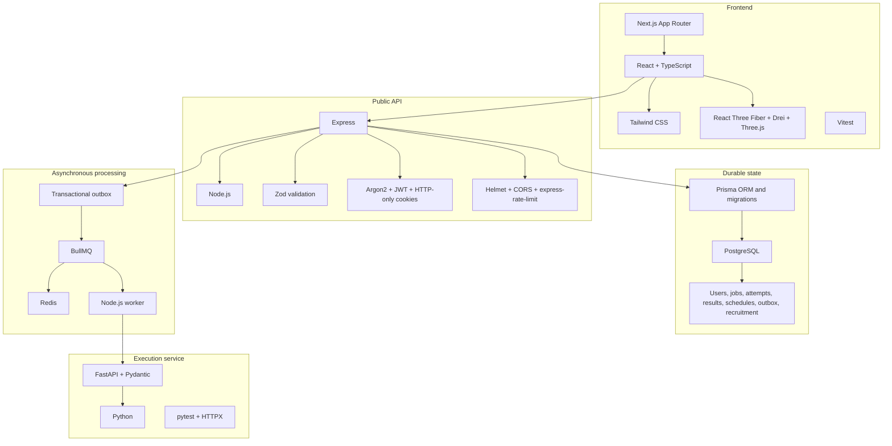
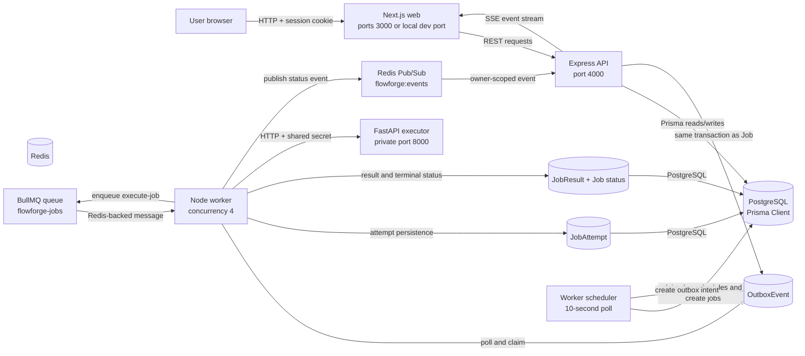

# FlowForge — Reliable Job Orchestration Platform

FlowForge is a full-stack recruitment and background-job orchestration platform. Recruiters can publish structured roles and review applications; candidates can explore jobs, inspect deterministic fit explanations, apply, and track application status. The orchestration workflow provides a separate engineering path for submitting, scheduling, executing, retrying, cancelling, and inspecting deterministic background tasks.

The project demonstrates durable PostgreSQL state, a transactional outbox, Redis/BullMQ processing, a private FastAPI executor, HTTP-only JWT sessions, owner- and role-scoped authorization, persisted attempts/results, best-effort SSE updates, and a Next.js operations and recruitment interface.

> This repository contains local and isolated-benchmark evidence, not a claim of public deployment, production readiness, exactly-once execution, or production-scale capacity.

## Contents

- [Product scope and verification](#product-scope-and-verification)
- [Technology stack](#technology-stack)
- [System architecture](#system-architecture)
- [Core job lifecycle](#core-job-lifecycle)
- [Implemented capabilities](#implemented-capabilities)
- [Engineering benchmark results](#engineering-benchmark-results)
- [Automated test evidence](#automated-test-evidence)
- [Local development setup](#local-development-setup)
- [Environment variables](#environment-variables)
- [PowerShell workflows](#powershell-workflows)
- [Security and limitations](#security-and-limitations)
- [Repository map and documentation](#repository-map-and-documentation)
- [Application screenshots](#application-screenshots)

## Product scope and verification

| Capability | Status | Evidence boundary |
|---|---|---|
| Cookie-based registration, login, logout, and current-user access | Implemented and API-tested | API tests cover validation, session cookies, and `/auth/me`; no credential values are documented here. |
| Owner-scoped orchestration jobs | Implemented and tested | API tests cover validation, ownership isolation, cancellation rules, retry rules, and outbox creation. |
| API → outbox → BullMQ → worker → executor lifecycle | Implemented and isolated-integration-tested | Two isolated API integration tests cover normal completion and controlled retry recovery. Optional direct Prisma assertions were not enabled in that run. |
| Persisted attempts and results | Implemented and integration-tested through API responses | The lifecycle test retrieves attempts and `/jobs/:id/result`; direct database assertions were not enabled for the recorded run. |
| Scheduling | Implemented and unit/API-tested | Persistent cron definitions, timezone validation, worker claiming, and scheduled job creation are implemented; no production scheduler SLA is claimed. |
| Recruitment postings, profiles, applications, and role checks | Implemented; partially verified | API and deterministic matching tests exist. The complete browser-level recruiter-to-candidate workflow has not been verified. |
| Three.js topology and accessible fallback | Implemented and frontend-tested | Status mapping is backed by the API health response; unavailable signals remain unknown. |
| Production deployment and scale | Not verified | No public deployment, CI result, penetration test, code coverage result, or production-scale load test is claimed. |

See [`IMPLEMENTATION_STATUS.md`](IMPLEMENTATION_STATUS.md) for the current verification snapshot and [`docs/METRICS_EVIDENCE_AUDIT.md`](docs/METRICS_EVIDENCE_AUDIT.md) for claim-by-claim evidence boundaries.

## Technology stack



| Technology | Role in FlowForge | Integration point |
|---|---|---|
| Next.js 15, React 19, TypeScript | App Router pages and typed client UI | `apps/web/app`, `apps/web/lib` |
| Tailwind CSS 4 | Global utility styling and design tokens | `apps/web/app/globals.css`, PostCSS config |
| React Three Fiber, Drei, Three.js | Interactive topology scene with fallback | `apps/web/components/topology` |
| Node.js and Express 5 | Public HTTP API and server startup | `services/api/src/app.ts`, `server.ts` |
| Zod | API configuration and request validation | `services/api/src/config.ts`, `app.ts` |
| Argon2 and `jsonwebtoken` | Password hashing and signed sessions | `services/api/src/auth.ts` |
| Helmet, CORS, `express-rate-limit` | Headers, origin policy, and in-process request limiting | `services/api/src/app.ts` |
| PostgreSQL 16 and Prisma 6 | Durable state, relations, constraints, indexes, and migrations | `database/prisma`, API/worker Prisma Client |
| Redis 7, BullMQ, ioredis | Queue coordination, retries, heartbeat, and Pub/Sub | `services/worker/src/index.ts`, API events/health |
| FastAPI, Pydantic, Uvicorn | Private task execution service and payload validation | `services/executor/app/main.py` |
| Vitest and Supertest | TypeScript unit/API tests | `services/api/tests`, `services/worker/tests`, `apps/web/**/*.test.*` |
| pytest and HTTPX | Python executor tests and HTTP tooling | `services/executor/tests`, `requirements.txt` |
| npm workspaces, TypeScript compiler, Docker Compose | Monorepo scripts, builds, and local service topology | Root `package.json`, Compose files, Dockerfiles |

The web manifest also declares TanStack Query and Lucide React; the README does not treat those packages as architectural dependencies because the current application paths do not rely on them as the primary data or icon layer.

## System architecture



Recruitment routes stay in the Express API and write recruitment tables through Prisma. Recruitment postings are not sent to BullMQ and are not executed by the worker.

The development Compose topology also contains a one-shot `migrate` service. The isolated benchmark Compose topology uses dedicated `benchmark-postgres`, `benchmark-redis`, and `benchmark-executor` services plus a separate network and PostgreSQL volume; only the benchmark API is published to `127.0.0.1:4400`.

## Core job lifecycle

```mermaid
sequenceDiagram
  participant B as Browser
  participant A as Express API
  participant P as PostgreSQL
  participant W as Worker
  participant R as Redis/BullMQ
  participant E as FastAPI executor

  B->>A: Login; receive flowforge_session cookie
  B->>A: POST /api/v1/jobs
  A->>P: Transaction: Job QUEUED + OutboxEvent
  P-->>A: Commit
  A-->>B: 202 Accepted with job ID
  loop Every worker outbox poll
    W->>P: Claim unpublished OutboxEvent
    W->>R: queue.add with job ID as deterministic BullMQ ID
    W->>P: Set publishedAt
  end
  R-->>W: execute-job message
  W->>P: CAS QUEUED/RETRYING to RUNNING; create attempt
  W->>E: POST /internal/execute with job payload and attempt
  alt Success
    E-->>W: ok, summary, result
    W->>P: Complete attempt; upsert JobResult; complete Job
  else Retryable failure
    E-->>W: retryable error
    W->>P: Fail attempt; set Job RETRYING
    W-->>R: BullMQ exponential retry
  else Final failure
    E-->>W: non-retryable error or retry limit reached
    W->>P: Fail attempt; set Job FAILED
  end
  W-->>A: Publish best-effort lifecycle event through Redis Pub/Sub
  A-->>B: SSE event when subscribed
  B->>A: GET job, attempts, or result for authoritative state
```

The API commits PostgreSQL before queue publication. PostgreSQL and Redis do not participate in one atomic transaction. If a process fails between queue publication and the `publishedAt` write, the outbox can be retried; the deterministic BullMQ ID makes repeated publication of the same logical job safer. This is at-least-once coordination, not exactly-once task execution.

## Implemented capabilities

### Authentication and authorization

- Registration validates `name`, `email`, and password length, hashes the password with Argon2, and creates a normal `USER` account.
- Login verifies the hash and issues an eight-hour JWT in the HTTP-only `flowforge_session` cookie.
- `requireAuth` returns `401` for missing or invalid sessions. `requireRole` returns `403` when the authenticated role is not allowed.
- Queries include the authenticated user or recruiter ID for owner-scoped resources.
- The current domain mapping is `USER` candidate and `ADMIN` recruiter.

### Orchestration jobs

Supported task types are `JSON_TRANSFORM`, `CSV_VALIDATE`, `REPORT_GENERATE`, and `FAILURE_SIMULATION`.

The API accepts JSON payloads, optional scheduled times, and an optional owner-scoped idempotency key. A repeated key with the same type/payload returns the existing job; conflicting reuse returns `409`. Jobs expose detail, attempt, and result endpoints, plus explicit cancellation and retry actions.

### Worker execution and reliability

The worker records each attempt, calls the executor with a 30-second timeout, validates the executor response, persists success/failure, and publishes lifecycle notifications. `MAX_ATTEMPTS` defaults to 3 and is bounded by configuration; BullMQ uses exponential backoff starting at 500 ms. Retryable failures become `RETRYING`; non-retryable failures or exhausted retries become `FAILED`.

The controlled failure task is intended for bounded demonstrations: it returns a retryable failure through a configured attempt number and succeeds after the configured threshold. It is not a production fault-injection facility.

### Scheduling and cancellation

Schedules persist five-field cron expressions, IANA timezones, payloads, enabled state, and next/last run times. The worker claims due schedules transactionally and creates ordinary jobs with outbox events. Cancellation applies to owner jobs in `QUEUED` or `RETRYING`; already-running arbitrary executor work is not promised to stop immediately.

### Results, dashboard, and live updates

`JobAttempt` records expose attempt status, duration, error code/message, and summary. `JobResult` stores one JSON result per job plus content metadata. The dashboard summary aggregates owner-scoped orchestration counts; recruitment pipeline counts are assembled from authorized application records.

The API publishes lifecycle events to Redis Pub/Sub and serves authenticated owner-scoped SSE at `/api/v1/events`. SSE is best effort: clients refresh authoritative REST state after reconnects. The topology page maps only API-reported health; SSE is represented as unknown because it is a per-user stream rather than a globally probeable service.

### Recruitment

Recruiters can create postings through `POST /api/v1/recruitment/jobs`; candidates can search open jobs, receive matched/missing skill explanations, apply once, and view applications. Recruiters can list applications for their own postings and update allowed application statuses. Candidate and recruiter/company profiles are persisted through role-scoped profile endpoints. Salary and contact information are not included in public job listings.

### Health and operations

- `GET /health/live` checks API process liveness without dependency queries.
- `GET /api/v1/system/health` checks PostgreSQL, Redis, worker heartbeat, executor liveness, and reports SSE as `unknown`.
- Executor `GET /health/live` supports API and Compose health checks.
- Request IDs, job IDs, event IDs, error codes, and structured worker/API logs support diagnosis.

## Engineering benchmark results

The measurements below are preserved in the raw artifacts and reconciled in [`docs/ENGINEERING_METRICS_REPORT.md`](docs/ENGINEERING_METRICS_REPORT.md) and [`docs/METRICS_EVIDENCE_AUDIT.md`](docs/METRICS_EVIDENCE_AUDIT.md). They were previously run locally; no benchmark was executed while writing this README.

| Artifact | Workload | Outcome | End-to-end latency | Throughput |
|---|---|---|---|---:|
| [`benchmark-run-results.json`](docs/benchmark-run-results.json) | 10 `JSON_TRANSFORM` jobs, concurrency 1, 100 ms polling, 0 warm-ups | 10 completed, 0 failed, 0 cancelled | p50 970.352 ms; p95/p99/max 1062.921 ms | 1.006 completed jobs/sec |
| [`benchmark-reliability.json`](docs/benchmark-reliability.json) | 10 `JSON_TRANSFORM` jobs, concurrency 1, 1000 ms polling, 0 warm-ups | 10 completed, 0 failed, 0 cancelled; 10/10 reported persisted results | p50 1062.571 ms; p95/p99/max 1081.744 ms | 0.926 completed jobs/sec |
| [`benchmark-run-50-c1-repeat.json`](docs/benchmark-run-50-c1-repeat.json) | 50 `JSON_TRANSFORM` jobs, concurrency 1, 1000 ms polling | 50 completed, 0 failed, 0 cancelled | p50 1040.045 ms; p95 1063.622 ms; p99/max 2074.470 ms | 0.921 completed jobs/sec |
| [`benchmark-run-50-c5-repeat.json`](docs/benchmark-run-50-c5-repeat.json) | 50 `JSON_TRANSFORM` jobs, concurrency 5, 1000 ms polling | 50 completed, 0 failed, 0 cancelled | p50 1059.288 ms; p95 1133.206 ms; p99/max 1141.883 ms | 4.552 completed jobs/sec |

The concurrency-5 repeat completed `4.552 / 0.921 = 4.942x` as many jobs per second as the concurrency-1 repeat, approximately 394.2% higher under these bounded local conditions. The median observed end-to-end latency was not lower at concurrency 5. The 1000 ms polling interval contributes materially to observed latency, so these numbers are not executor CPU duration or production SLA measurements.

The same retained artifacts show one controlled retry recovery: attempt 1 `FAILED`, attempt 2 `COMPLETED`, final job `COMPLETED`. One idempotency check returned the same job ID for a repeated request and returned HTTP `409` for conflicting payload reuse. These are correctness checks for bounded fixtures, not general reliability or contention rates.

## test evidence

The following results were previously observed locally and are recorded here as historical evidence. They were not rerun during this README task.

| Command | Result | Scope and caveat |
|---|---|---|
| `npm.cmd test` | API 21/21; worker 6/6 | Unit/API and worker suites. |
| `npm.cmd --workspace apps/web run test` | 15/15 across 6 files | Frontend Vitest suite. |
| `python -m pytest services/executor/tests` | 6/6 | One pytest cache warning (`WinError 183`); no test failed because of it. |
| `npm.cmd --workspace services/api run test:integration` | 2/2 | Isolated benchmark API: normal lifecycle and controlled retry recovery. Optional direct Prisma assertions were not enabled. |
| `npm.cmd run typecheck` | Passed | Contracts build plus API, worker, and frontend TypeScript checks completed without visible errors. |
| `npm.cmd run build` | Passed | Contracts, API, worker, and Next.js production builds completed; Next.js generated 15 static pages. |

The current unit/API/worker/frontend/executor total is 48/48. The two integration tests are reported separately and are not added as an independent population to that total; they are part of API integration coverage. Pass rate is not code coverage, and no coverage tool is configured.

## Local development setup

### Prerequisites

Use versions compatible with the checked-in manifests and Dockerfiles:

- Node.js with npm and the repository lockfile.
- Python 3.12 or a compatible Python environment for the executor.
- PostgreSQL 16-compatible database and Redis 7 for local non-Docker execution.
- Docker Desktop with Compose for the complete containerized stack.

### PowerShell setup with local services

From the repository root:

```powershell
Copy-Item .env.example .env
npm.cmd install
npm.cmd run db:generate
npm.cmd run db:migrate
npm.cmd run db:seed
npm.cmd run dev
```

The seed reads the environment-controlled candidate and recruiter account variables. Set explicit local values in `.env`; do not reuse them in production. The seed is intended for a development database and is not a database reset operation, but it can upsert the configured accounts and sample data.

### PowerShell setup with Docker Compose

Validate Docker before starting:

```powershell
docker info
docker compose config
docker compose up --build -d
docker compose run --rm api npm run db:seed
```

The development Compose file starts PostgreSQL, Redis, executor, a one-shot migration service, API, worker, and web. The migration service runs `prisma migrate deploy`; API and worker depend on its successful completion. The seed command is explicit and should run only after PostgreSQL and migrations are ready.

To stop the development containers without deleting the PostgreSQL volume:

```powershell
docker compose stop
```

Do not use volume-reset or database-reset commands when preserving local data matters.

### Development checks

```powershell
npm.cmd test
npm.cmd --workspace apps/web run test
python -m pytest services/executor/tests
npm.cmd run typecheck
npm.cmd run build
```

The root `npm.cmd test` script runs the API and worker suites. The web and Python commands are separate because they are separate workspaces/toolchains.

## Environment variables

Values are intentionally omitted. Use `.env.example` as the local template and keep real secrets outside the repository.

| Variable | Consumer | Requiredness | Purpose |
|---|---|---|---|
| `DATABASE_URL` | API, worker, Prisma CLI, seed | Required | PostgreSQL connection string. |
| `REDIS_URL` | API health/events, worker | Optional in code defaults; required for full queue/live behavior | Redis connection string. |
| `JWT_SECRET` | API | Required; minimum length is validated | Signs and verifies session JWTs. |
| `EXECUTOR_SHARED_SECRET` | API, worker, executor | Required for aligned service authentication | Bearer secret for worker-to-executor requests. |
| `EXECUTOR_URL` | API health, worker | Optional in code defaults; required to reach the selected executor | Internal executor URL. |
| `API_PORT` | API | Optional; defaults to `4000` | Express listen port. |
| `WEB_ORIGIN` | API | Optional; defaults to localhost web origin | Comma-separated CORS allowlist. |
| `COOKIE_SECURE` | API | Optional; defaults to false for local HTTP | Enables the cookie `Secure` attribute. Use HTTPS in deployed environments. |
| `MAX_ATTEMPTS` | API/worker | Optional; defaults to `3`, bounded from 1 to 10 | Retry attempt limit. |
| `NEXT_PUBLIC_API_URL` | Web | Optional; defaults to `http://localhost:4000/api/v1` | Browser-facing API base URL. |
| `DEMO_EMAIL`, `DEMO_PASSWORD` | Seed | Optional code defaults; set explicitly for local work | Candidate development account. |
| `RECRUITER_EMAIL`, `RECRUITER_PASSWORD` | Seed | Optional code defaults; set explicitly for local work | Recruiter/admin development account. |

### Isolated integration variables

The API integration test is opt-in and must target only the isolated benchmark environment:

| Variable | Role |
|---|---|
| `FLOWFORGE_INTEGRATION_TESTS` | Must be set to `1` to enable the tests. |
| `FLOWFORGE_BENCHMARK_API_URL` | Must target `http://127.0.0.1:4400/api/v1`. |
| `FLOWFORGE_INTEGRATION_EMAIL` | Dedicated isolated benchmark account email. |
| `FLOWFORGE_INTEGRATION_PASSWORD` | Dedicated isolated benchmark account password. |
| `FLOWFORGE_INTEGRATION_DATABASE_URL` | Optional guarded direct Prisma assertions; must target the benchmark database, never development PostgreSQL. |

Never point these integration variables at the development API, database, Redis, or volumes.

## PowerShell workflows

Inspect available scripts without changing the repository:

```powershell
Get-Content package.json
Get-ChildItem apps,services,packages -Filter package.json -Recurse
```

Run the isolated integration tests after the benchmark stack and dedicated account are already configured:

```powershell
$env:FLOWFORGE_INTEGRATION_TESTS = '1'
# Set the remaining FLOWFORGE_INTEGRATION_* values from a private local configuration.
npm.cmd --workspace services/api run test:integration
```

The command contacts the isolated API and creates test-owned benchmark jobs. It should not be used against development services.

If a source change must be delivered to the isolated benchmark API, the API image must contain the updated source because `docker-compose.benchmark.yml` uses an image rather than a source bind mount. The documented targeted workflow is:

```powershell
docker compose build api
if ($LASTEXITCODE -eq 0) {
  docker compose -p flowforge-benchmark -f docker-compose.benchmark.yml up -d --no-deps --force-recreate benchmark-api
}
```

This targets only the API image build and isolated benchmark API recreation; it does not apply migrations or modify database data. Review image tags and disk space before using it.

For the isolated benchmark Compose configuration itself:

```powershell
docker compose -p flowforge-benchmark -f docker-compose.benchmark.yml config
docker compose -p flowforge-benchmark -f docker-compose.benchmark.yml ps
```

The benchmark stack has its own PostgreSQL volume/network and publishes only API port `4400` on loopback. Benchmark migrations and seed operations are explicit and should be run only after confirming the target.

## Security and limitations

Implemented controls include:

- Argon2 password hashing and HTTP-only, SameSite session cookies.
- JWT verification through protected middleware.
- Candidate/recruiter role checks and owner/recruiter resource filters.
- Zod request/configuration validation and Pydantic executor validation.
- CORS origin allowlisting, Helmet headers, JSON body limits, and an in-process rate limiter.
- Internal executor bearer-secret validation.
- An allowlisted executor task dispatcher with no arbitrary code or shell execution.
- Safe public error envelopes with request IDs rather than stack traces.

Production recommendations include HTTPS, `COOKIE_SECURE=true`, managed secret storage, persistent object storage for large outputs, database/Redis availability planning, and external log/metric aggregation. The repository does not claim that these production controls or a deployment have been verified.

Known limitations:

- The complete browser-level recruiter-to-candidate workflow has not been verified.
- SSE reconnect and cross-user delivery have not been validated by a full authenticated browser E2E run; REST remains authoritative after reconnect.
- No production-scale load, uptime, penetration, or predictive matching-accuracy measurement exists.
- Resume object storage, password recovery, external market data, and a dedicated recruiter applicant-management screen remain incomplete or follow-up work.
- Queue and executor processing are at least once; exactly-once external side effects are not guaranteed.

See [`docs/SECURITY.md`](docs/SECURITY.md), [`docs/ENGINEERING_LEARNINGS.md`](docs/ENGINEERING_LEARNINGS.md), and [`IMPLEMENTATION_STATUS.md`](IMPLEMENTATION_STATUS.md) for additional boundaries and verified troubleshooting lessons.

## Repository map and documentation

| Path | Purpose |
|---|---|
| `apps/web/app` | Next.js pages for auth, dashboard, jobs, recruitment, profile, schedules, settings, and topology |
| `apps/web/lib` | Browser API client, types, forms, matching/display helpers, and frontend tests |
| `apps/web/components/topology` | Health mapping, topology graph tests, Three.js scene, and fallback |
| `services/api/src` | Express routes, auth, health, events, configuration, and recruitment logic |
| `services/api/tests` | API unit and authorization tests |
| `services/api/integration` | Opt-in isolated lifecycle integration tests |
| `services/worker/src` | Outbox publisher, scheduler, BullMQ worker, lifecycle persistence, and shutdown |
| `services/worker/tests` | Retry and executor-response unit tests |
| `services/executor/app` | FastAPI task handlers and internal execution endpoint |
| `services/executor/tests` | Python task validation and failure-handling tests |
| `packages/contracts` | Shared job/status/executor types and cron utilities |
| `database/prisma` | Prisma schema and migration history |
| `infra/scripts` | PowerShell diagnostics and benchmark runner |
| `docker-compose.yml` | Development service topology |
| `docker-compose.benchmark.yml` | Isolated benchmark service topology |

Detailed references:

- [`docs/ARCHITECTURE.md`](docs/ARCHITECTURE.md) — component boundaries, lifecycle, persistence, and deployment topology.
- [`docs/API.md`](docs/API.md) — public route conventions and protocol notes.
- [`docs/DATA_MODEL.md`](docs/DATA_MODEL.md) — durable entities and lifecycle states.
- [`docs/SECURITY.md`](docs/SECURITY.md) — security controls and deployment requirements.
- [`docs/DEPLOYMENT.md`](docs/DEPLOYMENT.md) — service deployment and readiness guidance.
- [`docs/DEMO_GUIDE.md`](docs/DEMO_GUIDE.md) — recruitment and orchestration demonstration sequence.
- [`docs/ENGINEERING_METRICS_REPORT.md`](docs/ENGINEERING_METRICS_REPORT.md) — detailed measured results and limitations.
- [`docs/BENCHMARK_RESULTS.json`](docs/BENCHMARK_RESULTS.json) — structured benchmark summary and historical records.
- [`docs/METRICS_EVIDENCE_AUDIT.md`](docs/METRICS_EVIDENCE_AUDIT.md) — claim-by-claim evidence audit.
- [`docs/ENGINEERING_LEARNINGS.md`](docs/ENGINEERING_LEARNINGS.md) — verified debugging lessons and trade-offs.
- [`docs/PROJECT_WALKTHROUGH.md`](docs/PROJECT_WALKTHROUGH.md) — interview-oriented product walkthrough.
- [`docs/RECRUITER_PROJECT_HIGHLIGHTS.md`](docs/RECRUITER_PROJECT_HIGHLIGHTS.md) — defensible recruiter-facing talking points.

## Application screenshots

Real screenshots can be added later without changing the README structure. The following views are present in the application:

- Dashboard / hiring workspace
- Job Studio
- Job details, attempts, and results
- System topology
- Schedules
- Explore Jobs and Post a Job
- Candidate or recruiter profile

<!-- TODO: add reviewed screenshots under docs/screenshots/ after capturing them from a running local environment.
Suggested files: dashboard.png, job-studio.png, job-detail.png, topology.png, schedules.png, recruitment.png, profile.png.
Do not add screenshots that contain credentials, tokens, private candidate data, or infrastructure secrets.
-->
