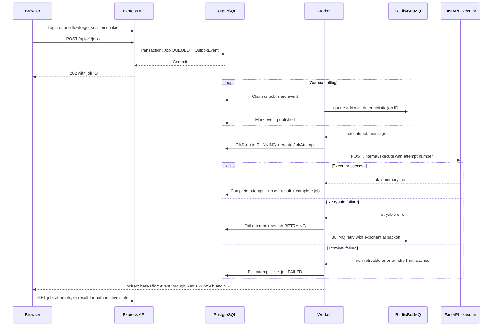

# FlowForge Architecture

FlowForge is a monorepo containing two related product areas:

- A reliable background-job workflow for submitting, scheduling, executing, retrying, cancelling, and inspecting deterministic tasks.
- A recruitment workflow for recruiter-owned postings, candidate profiles, explainable matching, applications, and application status updates.

The recruitment domain uses the same authenticated API and PostgreSQL database, but its postings and applications are not executable queue jobs. The job-orchestration path is the system's asynchronous processing demonstration; the recruitment path is the product-facing workflow.

## 1. System overview

The architecture is a service-oriented monorepo with a browser-facing Next.js application, a public Express API, a Node.js worker, and a private FastAPI executor. PostgreSQL is the durable source of truth. Redis is used for BullMQ coordination, worker heartbeats, and best-effort event delivery. The API's current request limiter is in-process; Redis is not required to persist the limiter's state. The browser communicates with Express only; it does not connect directly to PostgreSQL, Redis, BullMQ, or FastAPI.

The implemented stack is:

| Area | Technology | Responsibility |
|---|---|---|
| Web | Next.js App Router, React, TypeScript | Authenticated UI, forms, job/recruitment views, topology, and API calls |
| Public API | Express, Zod, Prisma Client | Authentication, authorization, validation, persistence, health, REST, and SSE |
| Durable state | PostgreSQL, Prisma migrations | Users, jobs, attempts, results, schedules, outbox events, and recruitment records |
| Queue | Redis, BullMQ | Queue messages, retry scheduling, and worker coordination |
| Worker | Node.js, TypeScript | Outbox publication, scheduling, execution attempts, executor calls, and lifecycle persistence |
| Executor | FastAPI, Pydantic, Python | Allowlisted CSV, JSON, report, and controlled-failure task handlers |
| Contracts | `packages/contracts` | Shared job types, statuses, executor shapes, and cron helpers |

The implementation uses at-least-once queue processing. It makes duplicate publication and stale lifecycle updates safer through deterministic queue IDs, conditional updates, unique database constraints, and idempotent result persistence. It does not claim exactly-once task execution.

## 2. Architecture diagram

```mermaid
flowchart LR
  Browser[Next.js browser UI]
  API[Express API]
  DB[(PostgreSQL\nPrisma)]
  Outbox[(OutboxEvent\ntransactional intent)]
  Redis[(Redis)]
  Queue[BullMQ queue]
  Worker[Node.js worker]
  Executor[FastAPI executor]
  Results[(JobAttempt\nJobResult\nJob status)]
  PubSub[Redis Pub/Sub\nflowforge:events]
  SSE[SSE /api/v1/events]

  Browser -->|REST, cookies| API
  Browser <-->|SSE, cookies| SSE
  API -->|Prisma transaction| DB
  API -->|creates Job + JOB_CREATED| Outbox
  Outbox -.->|same PostgreSQL transaction| DB
  Worker -->|polls unpublished events| DB
  Worker -->|queue.add deterministic jobId| Queue
  Queue -->|execute-job message| Worker
  Worker -->|HTTP POST /internal/execute| Executor
  Worker -->|attempt/result/status transactions| Results
  Results -.->|Prisma persistence| DB
  Worker -->|publish lifecycle event| PubSub
  PubSub -->|owner-scoped subscription| SSE
  Worker -->|health heartbeat| Redis
  API -->|Redis PING + worker heartbeat| Redis
  Queue -.->|Redis-backed BullMQ data| Redis
```



The dashed database and Redis edges indicate coordination or persistence details rather than a browser-visible protocol. PostgreSQL and Redis are not connected directly to the frontend.

## 3. Component responsibilities

### Frontend

The Next.js App Router application is under `apps/web/app`. Routes include:

- `/login` and `/register` for session establishment.
- `/dashboard` for account-scoped operational summary and recruitment activity.
- `/jobs`, `/jobs/new`, and `/jobs/[id]` for orchestration job submission and inspection.
- `/schedules` for persistent recurring job definitions.
- `/recruitment` and `/recruitment/new` for candidate discovery and recruiter posting.
- `/profile` and `/settings` for authenticated account/profile views.
- `/topology` for the health-backed 3D topology and accessible fallback.

`apps/web/lib/api.ts` uses `NEXT_PUBLIC_API_URL`, defaults to the local API prefix, sends `credentials: 'include'`, applies an eight-second request timeout, and maps API error envelopes to user-facing errors. The frontend does not contain database, Redis, queue, or executor credentials. The topology scene is dynamically loaded client-side; the page includes reduced-motion handling and a non-WebGL fallback.

### Express API

`services/api/src/app.ts` creates the public HTTP boundary. It assigns request IDs, applies Helmet, CORS, JSON body limits, cookie parsing, and an in-process rate limiter before registering route groups. Zod schemas validate request bodies at the API boundary. Prisma is instantiated in the API process and is the API's database access layer.

The API owns:

- Authentication and session cookies.
- Owner and role authorization.
- Job creation, listing, detail, result, attempt, retry, and cancellation endpoints.
- Schedule persistence and validation.
- Recruitment profile, posting, application, and status endpoints.
- Dashboard summary aggregation.
- Dependency health aggregation.
- The authenticated SSE endpoint.

The final error middleware returns a consistent error envelope with `code`, `message`, and `requestId`. Profile schema errors caused by missing Prisma tables/columns are mapped to a specific `PROFILE_SCHEMA_UNAVAILABLE` response; other unexpected errors use `INTERNAL_ERROR`.

### Authentication and authorization

`services/api/src/auth.ts` hashes passwords with Argon2 and signs a JWT containing `userId` and the `USER` or `ADMIN` role. The token is stored in the HTTP-only `flowforge_session` cookie for eight hours. Cookie `SameSite` is `lax`; `Secure` is controlled by `COOKIE_SECURE` and defaults to false for local HTTP development.

`requireAuth` verifies the cookie and rejects missing or invalid sessions with `401`. `requireRole` builds on it and rejects an authenticated user with the wrong role using `403`. Resource queries also include the authenticated owner or recruiter ID, so knowing an identifier is not sufficient to read or mutate another user's data.

### PostgreSQL and Prisma

`database/prisma/schema.prisma` is the sole schema owner. The API and worker share the generated Prisma Client and migration files. PostgreSQL stores authoritative lifecycle and recruitment state; Redis contents are not treated as permanent history.

### Outbox and queue publication

The API creates a `Job` and its `OutboxEvent` inside one Prisma transaction. The worker's `publishOutbox` loop claims unpublished rows with `processingAt`, publishes a BullMQ `execute-job` message, and marks the event `publishedAt` only after queue publication succeeds. Stale processing claims older than 60 seconds are released.

The database transaction and Redis publication are separate systems and are not atomically committed together. If publication succeeds before the database mark is written, a later poll can attempt publication again. The deterministic BullMQ `jobId` is the application job ID, which prevents duplicate logical queue entries. This is an at-least-once design, not an exactly-once guarantee.

### Worker

`services/worker/src/index.ts` owns the BullMQ consumer, outbox poller, schedule poller, Redis event publisher, and worker heartbeat. It runs with configured concurrency 4. For each queue message it:

1. Reads the current job.
2. Exits for missing, cancelled, or completed jobs.
3. Performs a transactionally guarded transition from `QUEUED` or `RETRYING` to `RUNNING`.
4. Creates a `JobAttempt` row.
5. Calls the private executor with the job payload and attempt number.
6. Persists success or failure and publishes a best-effort lifecycle event.

The worker closes the BullMQ worker, queue, Redis connection, and Prisma client on `SIGTERM`/`SIGINT`.

### FastAPI executor

`services/executor/app/main.py` exposes a liveness endpoint and the internal `POST /internal/execute` endpoint. The request is validated by Pydantic and contains `jobId`, `type`, `payload`, and `attempt`. A bearer token derived from `EXECUTOR_SHARED_SECRET` is required.

The executor dispatches only the supported types in `packages/contracts`: `JSON_TRANSFORM`, `CSV_VALIDATE`, `REPORT_GENERATE`, and `FAILURE_SIMULATION`. It performs bounded deterministic transformations and returns `{ ok, summary, result }` on success or a structured error with a `retryable` flag. It does not evaluate user code, shell commands, arbitrary Python, or expressions.

### Results, attempts, and lifecycle state

Each actual worker execution gets a `JobAttempt`. Successful execution updates the attempt, upserts the unique `JobResult`, and marks the job `COMPLETED` in one Prisma transaction. Failed execution updates the attempt and marks the job `RETRYING` or `FAILED`. The API exposes attempts and results through owner-scoped routes, allowing the frontend to distinguish a terminal result from an in-flight job.

### Scheduling

The API validates a documented five-field cron subset and IANA timezone using `packages/contracts/src/schedule.ts`. It persists `ScheduledJob.nextRunAt`. The worker checks enabled due schedules every ten seconds, conditionally claims each schedule using its current `nextRunAt`, calculates the next occurrence, and transactionally creates an ordinary `Job` plus outbox event. The schedule ID and occurrence timestamp form the scheduled job's idempotency key.

### Cancellation, retry, and dashboard summary

`POST /jobs/:id/cancel` conditionally changes only owner jobs in `QUEUED` or `RETRYING` to `CANCELLED`. It does not promise instantaneous termination of executor work already in progress. The worker checks cancellation before execution and uses conditional lifecycle updates.

`POST /jobs/:id/retry` accepts only an owner job in `FAILED`, changes it back to `QUEUED`, and creates another outbox event. It does not erase prior attempt history.

`GET /dashboard/summary` aggregates owner-scoped orchestration counts for total, completed, failed, running, queued, and success rate. Recruitment dashboard pipeline counts are assembled by the frontend from authorized recruitment application data.

### SSE and live updates

The worker publishes lifecycle events to the Redis `flowforge:events` channel. The API maintains a Redis subscriber and keeps in-memory listeners keyed by owner ID. `GET /api/v1/events` authenticates before opening a `text/event-stream` response, sends a `ready` event, forwards owner-matching `job` events, emits a heartbeat every 20 seconds, and removes the listener on disconnect.

SSE is best effort. The frontend must refresh REST state after reconnecting or when SSE is unavailable. The system-health response reports SSE as `unknown` because it is an authenticated per-user stream rather than a globally probeable service.

### Health and observability

- API `/health/live` returns a process-level liveness response without dependency checks.
- API `/api/v1/system/health` checks a PostgreSQL `SELECT 1`, Redis `PING`, the worker heartbeat key, and executor `/health/live`. It reports `ok`, `unhealthy`, or `unknown` signals and returns `degraded` when any service is unavailable or unknown. PostgreSQL failure produces `503`.
- Executor `/health/live` is used by the API and Compose health checks.
- Worker logs are structured JSON for publish, execution, heartbeat, and schedule errors; request IDs and job IDs are included where available.
- Durable job detail, attempt, result, and schedule records provide operational history beyond ephemeral logs and Redis data.

## 4. Core job lifecycle



The API does not enqueue before the creation transaction commits. The worker's database writes and executor call are also separate from Redis queue acknowledgement; a timeout does not prove that an executor-side operation did not run.

## 5. State and persistence model

The orchestration models and important relationships are:

| Model | Purpose and relationships |
|---|---|
| `User` | Account identity, Argon2 password hash, role, and ownership root for jobs and schedules. Also relates to recruitment profiles, postings, and applications. |
| `Job` | Executable task request, owner, payload, lifecycle timestamps, optional idempotency key, summary, attempts, result, and outbox events. |
| `JobAttempt` | One persisted execution attempt per job and attempt number, with status, duration, errors, and summary. `(jobId, attemptNumber)` is unique. |
| `JobResult` | One optional durable result per job. `jobId` is unique and supports JSON or output metadata. |
| `ScheduledJob` | Durable owner-scoped recurring definition with type, payload, cron expression, timezone, enabled flag, next run, and last run. |
| `OutboxEvent` | Durable publication intent linked to a job, with event type, payload, processing lease timestamp, and publication timestamp. |

The schema indexes owner/creation queries, job status/creation queries, attempt ordering, enabled schedules/next run, unpublished outbox ordering, and recruitment access patterns. Cascading relationships are defined in Prisma for dependent history and recruitment records.

Recruitment models are separate:

- `RecruitmentJob` belongs to a recruiter and has an indexed status/creation and recruiter/creation path.
- `CandidateProfile` belongs one-to-one to a user and owns repeatable education, experience, certification, and language rows.
- `RecruiterProfile` belongs one-to-one to a user and optionally owns one `CompanyProfile`.
- `Application` links a candidate to a recruitment job, has a status, and enforces unique `(recruitmentJobId, candidateId)`.

The API and worker read/write orchestration entities. Recruitment routes write recruitment entities through Prisma in the API process. The executor does not access PostgreSQL.

## 6. State transitions and reliability

### Job states

The persisted `JobStatus` enum is:

```text
QUEUED -> RUNNING -> COMPLETED
                  ├-> RETRYING -> RUNNING
                  └-> FAILED
QUEUED/RETRYING -> CANCELLED
FAILED -> QUEUED   (explicit retry endpoint)
```

The worker uses conditional updates so only `QUEUED` or `RETRYING` jobs can enter `RUNNING`. It ignores already `CANCELLED` or `COMPLETED` jobs. The API only exposes cancellation for queued/retrying owner jobs and retry for failed owner jobs. A stale worker update therefore cannot turn a cancelled or completed job into a successful terminal state through the normal guarded path.

### Retry behavior

`MAX_ATTEMPTS` is configurable from 1 to 10 and defaults to 3. BullMQ is configured with that attempt limit and exponential backoff starting at 500 ms. The worker retries only when the validated executor response has `ok: false` and `error.retryable: true`, and the configured attempt limit has not been reached. Invalid task input from the executor is marked non-retryable. Executor timeouts, transport errors, and malformed responses are treated by the worker as retryable executor-unavailable failures.

### Idempotency and duplicate delivery

Job creation checks an owner-scoped idempotency key inside the creation transaction. A repeated key with the same type and JSON payload returns the existing job; a conflicting payload returns `409`. The schema also has a composite uniqueness constraint for owner and key. Queue publication uses the application job ID as the BullMQ job ID, so repeated outbox publication does not create a second logical queue job. These controls reduce duplicate processing but do not prove exactly-once external side effects.

### Outbox failure boundary

The outbox row is committed with the job before the worker attempts Redis publication. Failed publication clears the processing marker for a later retry, and stale claims are reclaimed. Because PostgreSQL and Redis are not one transaction, a crash between queue publication and `publishedAt` update is handled by at-least-once reconciliation rather than an exactly-once claim.

### Cancellation and recovery limits

Cancellation is a durable request/state transition for work that has not entered execution. A running executor call has a 30-second request timeout in the worker, but there is no general process-level cancellation protocol for arbitrary executor work. A worker restart leaves durable jobs and unprocessed outbox rows in PostgreSQL; recovery depends on the worker's subsequent polling and BullMQ's durable queue state.

## 7. API and service communication

The public API prefix is `/api/v1`. Error responses use `{ error: { code, message, requestId } }`.

| Route group | Implemented examples | Boundary |
|---|---|---|
| Auth | `POST /auth/register`, `POST /auth/login`, `POST /auth/logout`, `GET /auth/me` | Public login/registration; cookie-authenticated account access |
| Orchestration jobs | `POST /jobs`, `GET /jobs`, `GET /jobs/:id`, `/attempts`, `/result`, `/cancel`, `/retry` | Authenticated and owner-scoped |
| Schedules | `POST/GET /schedules`, `GET/PATCH/DELETE /schedules/:id` | Authenticated and owner-scoped; cron/timezone validated |
| Profiles | `GET /profile`, `PUT /profile/candidate`, `PUT /profile/recruiter` | Role-scoped; candidate and recruiter data remain private to authorized flows |
| Recruitment | `POST/GET /recruitment/jobs`, job detail, candidate apply/history, recruiter applicants/status update | `USER` candidates and `ADMIN` recruiters enforced by middleware and ownership filters |
| Dashboard | `GET /dashboard/summary` | Authenticated, owner-scoped orchestration summary |
| System | `GET /system/health`, `GET /openapi.json` | Health is public; OpenAPI output is a minimal route description |
| Events | `GET /events` | Authenticated SSE, owner-scoped through event payload filtering |

Express calls FastAPI only from the worker. The API never exposes the executor's `/internal/execute` endpoint as a public operation. The worker sends JSON plus an internal bearer token to the executor and validates the response shape before persisting it.

## 8. Security architecture

Implemented controls include:

- Argon2 password hashing; only the hash is stored.
- JWT sessions in HTTP-only, root-scoped cookies. `COOKIE_SECURE` must be enabled with HTTPS outside local HTTP development.
- Zod validation at the public API boundary and Pydantic validation at the executor boundary.
- `requireAuth` and `requireRole` middleware plus owner/recruiter filters on resource queries.
- CORS allowlisting from `WEB_ORIGIN` with credentials enabled.
- Helmet security headers and a 1 MB Express JSON body limit.
- An Express rate limiter with a 120-request/minute in-process limit in the API process.
- A shared secret on worker-to-executor requests.
- A restricted executor dispatch table; no arbitrary code, shell, or user expression execution.
- Public error envelopes that avoid returning stack traces; request IDs support log correlation.

Secrets and connection strings are supplied through environment variables. The checked-in Compose and environment examples use development placeholders; production secret storage, HTTPS, persistent object storage, and stronger operational controls remain deployment responsibilities. This document does not claim a penetration test or production security certification.

## 9. Failure handling and recovery

| Failure | Implemented behavior | Boundary or limitation |
|---|---|---|
| API process failure | HTTP service becomes unavailable; durable PostgreSQL state remains | No external supervisor is defined by the application itself |
| PostgreSQL failure | System health marks PostgreSQL unhealthy and returns `503`; request handlers surface safe errors | Existing in-flight transactions may fail and require client retry |
| Redis/queue failure | Outbox publication leaves rows retryable; health reports Redis unhealthy; executor/event connections are bounded | Redis Pub/Sub is best effort and not a durable event log |
| Worker restart | Shutdown closes worker/queue/Redis/Prisma clients; durable outbox and jobs remain | Recovery depends on the restarted worker and BullMQ state; no separate watchdog is implemented |
| Executor timeout | Worker maps the 30-second timeout to a retryable executor-unavailable outcome | A timeout cannot prove whether executor work began or completed |
| Invalid executor response | Worker validation rejects malformed response and treats the call as retryable-unavailable | Repeated malformed responses eventually fail after the attempt limit |
| Retry exhaustion | Final attempt is persisted as `FAILED` with sanitized error code/message | No automatic dead-letter dashboard is implemented |
| Duplicate API request | Same owner/key/payload returns existing job; conflicting payload returns `409` | Concurrent external side effects are not made exactly once by this mechanism |
| Outbox publication failure | Processing marker is cleared; later poll retries publication | PostgreSQL-plus-Redis publication is not atomic |
| SSE disconnect | Client connection is cleaned up; frontend can reconnect and refresh REST state | Missed Pub/Sub messages are not replayed from a durable event stream |

## 10. Deployment and runtime topology

The development Compose file defines:

| Service | Image/build | Network role | Published port |
|---|---|---|---:|
| `postgres` | `postgres:16-alpine` | Durable development database and `flowforge-postgres` volume | `5432` |
| `redis` | `redis:7-alpine` | Queue, heartbeat, rate-limit/event coordination | `6379` |
| `executor` | `services/executor/Dockerfile` | Private internal task execution | `8000` |
| `migrate` | API Dockerfile, one-shot command | Runs `prisma migrate deploy` after PostgreSQL health | none |
| `api` | `services/api/Dockerfile` | Public API; waits for migration and dependency health | `4000` |
| `worker` | `services/worker/Dockerfile` | Queue consumer and scheduler | none |
| `web` | `apps/web/Dockerfile` | Next.js frontend | `3000` |

The API and worker Dockerfiles build from the repository root, copy `database`, run `npm ci`, generate Prisma Client, and include migration files. Their development container command runs the workspace `dev` script. The executor image builds from `services/executor`, installs its Python requirements, and runs Uvicorn on port 8000.

Compose health gates PostgreSQL, Redis, and executor startup. API and worker depend on successful migration completion in the development file. The migration service is one-shot and may be stopped after a successful deployment; it is not a long-running application service.

The isolated benchmark Compose file uses the same API/worker/executor image families with a dedicated `flowforge-benchmark-postgres` volume, `flowforge-benchmark-net` network, service names `benchmark-postgres`, `benchmark-redis`, and `benchmark-executor`, and only `127.0.0.1:4400` published for the benchmark API. Benchmark database, Redis, and executor ports are not published. Benchmark migrations and seed operations are explicit actions, not automatic development startup behavior.

## 11. Observability and operational verification

Operational verification is based on:

- `/health/live` for process liveness.
- `/api/v1/system/health` for PostgreSQL, Redis, worker heartbeat, executor, and deliberately unknown SSE status.
- Compose health checks for PostgreSQL, Redis, executor, and API.
- Structured API and worker logs with request IDs, job IDs, event IDs, error codes, and durations where available.
- REST job detail, attempt, result, schedule, profile, and application history.
- Dashboard summary counts derived from PostgreSQL queries and authorized recruitment application data.
- The bounded benchmark artifacts and evidence audit in [`ENGINEERING_METRICS_REPORT.md`](ENGINEERING_METRICS_REPORT.md) and [`METRICS_EVIDENCE_AUDIT.md`](METRICS_EVIDENCE_AUDIT.md).

The repository does not include a full metrics backend, distributed tracing system, coverage tool, or production log aggregation configuration. See [`IMPLEMENTATION_STATUS.md`](../IMPLEMENTATION_STATUS.md) for current verification boundaries.

## 12. Recruitment subsystem boundary

Recruitment is implemented in API routes beginning at `/api/v1/profile` and `/api/v1/recruitment`. `RecruitmentJob`, `CandidateProfile`, `RecruiterProfile`, `CompanyProfile`, and `Application` are separate Prisma models from executable `Job`, `JobAttempt`, `JobResult`, `ScheduledJob`, and `OutboxEvent`.

`ADMIN` accounts are the recruiter role in the current enum. Recruiters can create postings and update applications only through recruiter-owned resources. `USER` accounts are candidates; they can read open postings, receive fit output based on their persisted profile, apply once per posting, and view their application history. Candidate salary/contact fields are not included in public job listings. The database uniqueness constraint on `(recruitmentJobId, candidateId)` prevents duplicate applications.

The API supports recruiter applicant listing and status updates. The complete browser-level recruiter-to-candidate workflow has not been verified as a full Playwright/browser E2E scenario, and no external market-data or paid LLM integration is required by the current implementation.

## 13. Architectural decisions and trade-offs

### PostgreSQL as the authority

Durable lifecycle state, attempts, results, schedules, outbox records, and recruitment data live in PostgreSQL. This makes history queryable after Redis restarts, but requires migrations, connection management, and careful transaction boundaries.

### Transactional outbox

Creating the job and publication intent in one database transaction prevents a committed job from having no durable enqueue intent. The cost is an asynchronous publisher and unavoidable at-least-once reconciliation between PostgreSQL and Redis.

### Separate worker and executor

The worker owns lifecycle transitions and persistence while FastAPI owns validated deterministic task execution. This keeps the public API responsive and prevents arbitrary user code from entering the execution path. It adds a service-to-service authentication and timeout boundary.

### Persistent attempts and results

Attempts and results make retries and final outcomes inspectable rather than inferred from queue state. They also require explicit idempotent result upserts and lifecycle guards when duplicate deliveries occur.

### Best-effort SSE over durable event replay

Redis Pub/Sub and SSE provide responsive updates with little infrastructure. They do not retain missed messages, so the frontend must treat REST state as authoritative after reconnects. Global SSE health remains `unknown` by design.

### Shared role model for the recruitment demo

The existing `USER`/`ADMIN` enum is reused as candidate/recruiter authorization rather than introducing a second account system. This avoids a parallel session model, but the naming is less domain-specific and recruiter onboarding remains seed/provisioning dependent.

## 14. Known limitations and future improvements

The current verified boundaries are summarized in [`IMPLEMENTATION_STATUS.md`](../IMPLEMENTATION_STATUS.md):

- No production deployment, CI result, penetration test, or production-scale load result is claimed.
- The benchmark measurements are bounded local runs and include polling delay.
- The complete browser-level recruiter-to-candidate workflow and authenticated SSE reconnect/cross-user delivery remain unverified.
- Resume object storage, password recovery, external market data, and predictive matching are not implemented.
- A dedicated recruiter applicant-management screen remains follow-up work even though applicant API routes exist.
- Exactly-once external side effects, durable event replay, and a distributed metrics/tracing backend are not implemented.

## 15. Repository reference map

The following paths are part of the implemented repository structure:

| Path | Role |
|---|---|
| `apps/web/app` | Next.js routes for auth, dashboard, jobs, recruitment, profile, schedules, settings, and topology |
| `apps/web/lib/api.ts` | Browser API client, credentials, timeout, and error mapping |
| `apps/web/components/shell.tsx` | Authenticated application shell and shared status/loading components |
| `apps/web/components/topology` | Topology graph mapping, tests, Three.js scene, and fallback support |
| `services/api/src/app.ts` | Express routes, validation, health, persistence, and SSE endpoint |
| `services/api/src/auth.ts` | Password hashing, JWT session cookie, and role middleware |
| `services/api/src/events.ts` | Redis Pub/Sub subscription and owner-scoped event listeners |
| `services/api/src/health.ts` | Redis and worker-heartbeat health checks |
| `services/worker/src/index.ts` | Outbox publisher, scheduler, BullMQ worker, lifecycle persistence, and shutdown |
| `services/worker/src/processor.ts` | Executor-response validation and retry decision logic |
| `services/executor/app/main.py` | FastAPI task validation, dispatch, execution, and internal auth |
| `packages/contracts/src/index.ts` | Shared job types, statuses, and executor contracts |
| `packages/contracts/src/schedule.ts` | Cron parsing, timezone validation, and next-occurrence calculation |
| `database/prisma/schema.prisma` | PostgreSQL schema, relations, constraints, and indexes |
| `database/prisma/migrations` | Prisma migration history |
| `docker-compose.yml` | Development service topology, health gates, ports, and volume |
| `docker-compose.benchmark.yml` | Isolated benchmark topology and resources |
| `services/api/Dockerfile` | API image with source, Prisma schema, migrations, and generated client |
| `services/worker/Dockerfile` | Worker image with shared Prisma schema/migrations and generated client |

For API route details, see [`API.md`](API.md). For database fields and relationships, see [`DATA_MODEL.md`](DATA_MODEL.md). For security controls and deployment requirements, see [`SECURITY.md`](SECURITY.md) and [`DEPLOYMENT.md`](DEPLOYMENT.md).
